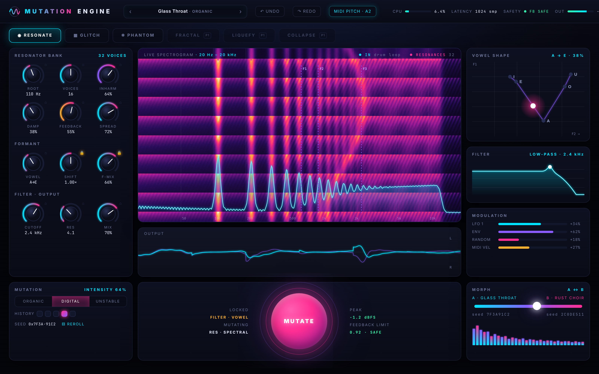

# MUTATION ENGINE

Experimental spectral resonator: 32-voice resonator bank, vowel formants, spectral/glitch processing and a seeded, musically-constrained MUTATE system. VST3 (macOS also AU). Primary test host: Ableton Live (macOS); Linux builds for REAPER / Bitwig.



*Design preview (HTML render in `Assets/ui-preview/`), not yet the JUCE editor. The current editor is the foundation version.*

## Status (steps 1-3 core)
- JUCE 8 / CMake project, stereo I/O, APVTS parameters, state save/restore, basic editor with live scope
- DSP (header-only, JUCE-free): `ResonatorBank`, `FilterBank`, `FormantEngine`
- MIDI pitch control of the resonator root
- Unit tests: impulse response, tuning, feedback stability, determinism, parameter-sweep safety, filter modes, formant peaks
- `SpectralEngine`: 1024-pt STFT (75% overlap), freeze with drifting partials, bin shift, bin dropout, bin scramble (seeded, deterministic). Constant 1024-sample latency, reported to the host; dry path is delay-compensated
- `GlitchEngine`: tempo-synced events (stutter, reverse, crush, gate) decided per grid step from a seeded RNG; follows host tempo/position
- Modes wired: **Resonate**, **Glitch**, **Phantom** (P0)
- **Mutation core** (`Source/Mutation/`, JUCE-free, fully unit-tested): see below
- Not yet: presets, full UI, P1 modes (Fractal, Liquefy, Collapse)

## Mutation
- [x] **Deterministic seed**: result depends only on (state, options). The result carries the next seed, so repeated MUTATE walks a reproducible sequence; the seed is shown and editable (`0x...` hex or decimal) and is saved with the project
- [x] **Parameter groups and locks**: lock a whole group (Resonator / Formant / Filter / Spectral / Glitch) or any single knob. Locked parameters are never modified, and locking one parameter never changes what the others become (every parameter consumes a fixed number of random draws)
- [x] **Intensity**: 0 = nothing changes; higher = more parameters touched and moved further
- [x] **Styles**: *Organic* (gentle, centre-weighted, pitch snapped to a minor pentatonic), *Digital* (stepped values, power-of-two voice counts, vowels snap to A E I O U), *Unstable* (edge-weighted extremes, microtonal pitch, heavy feedback and inharmonicity)
- [x] **Undo / redo** snapshots (64 deep). Undo first commits manual tweaks, so hand-made changes are recoverable
- [x] **Morph** between two mutations: MUTATE sets A = before, B = after; `SET A` / `SET B` capture any sound. Only mutable, unlocked parameters morph
- [x] **Safety**: feedback ceiling with a damping floor, filter Q and low-pass cutoff limits, dropout never silences everything, bin-shift limit, and a **CPU budget** that lowers the maximum resonator voice count when the audio thread is busy. Safety adjusts only unlocked parameters; the DSP's own hard limits and the output soft-clipper remain the last line of defence

`Source/ParamTable.h` is the single source of truth for every parameter; the JUCE layout and the mutation rules are both generated from it.

## Tests
`me_dsp_tests` (DSP), `me_mutation_tests` (mutation core) and `MutationEngineSmoke` (real processor + parameter tree, headless) all run in CI.

## Build
```bash
# DSP tests only (no JUCE download)
cmake -S . -B build -DME_BUILD_PLUGIN=OFF && cmake --build build && ctest --test-dir build --output-on-failure
# Plugin (fetches JUCE 8.0.6)
cmake -S . -B build-plugin -DME_BUILD_TESTS=OFF && cmake --build build-plugin --target MutationEngine_VST3
```
Linux needs: `libasound2-dev libfreetype6-dev libfontconfig1-dev libx11-dev libxrandr-dev libxinerama-dev libxcursor-dev libxext-dev libgl1-mesa-dev`.
